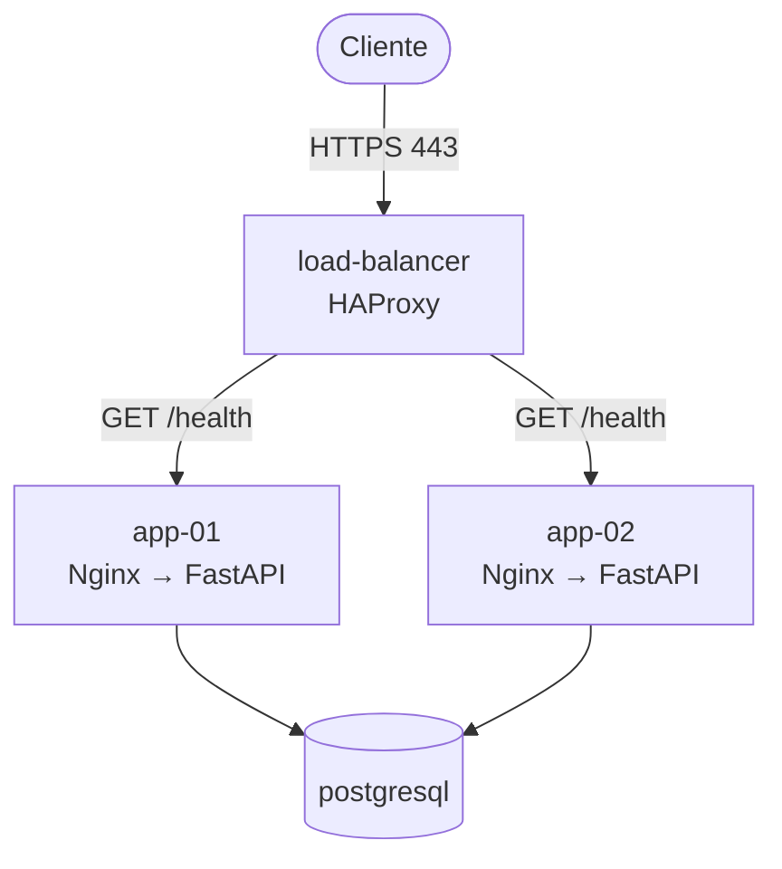

# Aegis Resilience Lab

Laboratório prático de arquitetura de alta disponibilidade, criado para avaliar padrões de resiliência em infraestrutura baseada em VMs e conduzir a evolução de uma aplicação containerizada para serviços gerenciados e Multi-AZ na AWS.

> **Aviso de anonimização.** Este é um case de estudo. O ambiente de origem é propositalmente anonimizado: nomes de componentes, endereços IP e domínios são genéricos ou fictícios (`load-balancer`, `app-01`, `app-02`, `postgresql`, faixa `10.0.10.0/24`, `api.aegis.example.com`). O contexto de negócio é fictício. Nenhum dado, credencial ou identificador real faz parte deste repositório.

## Estado atual e roadmap

Cada documento deste repositório declara, no topo, em qual destes três estados está o que descreve.

| Estado | Significado | O que está nele hoje |
| --- | --- | --- |
| **Implementado e validado** | Existe ou existiu, e tem evidência datada | Origem: alta disponibilidade da camada de aplicação, testada em 03/10/2026. AWS: arquitetura alvo criada por Terraform em um laboratório efêmero, com perda de task, deploy defeituoso, restauração de backup e failover do banco testados em 03 e 04/10/2026 |
| **Proposto** | Desenho decidido, ainda não construído | Perfil resiliente permanente: NAT por zona, Multi-AZ contínuo, certificado público, auto scaling |
| **Roadmap** | Evolução futura | IA aplicada à operação, WAF, escala de leitura no banco, deploy automático |

O que o laboratório de origem **não** tem: replicação ou failover de banco, segundo load balancer, backup comprovado, alertas, métricas, dashboards, centralização de logs, auto scaling e IA. Essas limitações são o ponto de partida do case, não um detalhe escondido: banco e load balancer são pontos únicos de falha.

A versão 1.1.0 da aplicação, presente neste repositório, corrige achados do assessment e é a que rodou na AWS. As evidências da origem são da versão 1.0.0. O ambiente da AWS é efêmero: fica ligado apenas durante as janelas de teste e estudo e é destruído ao fim delas; não há endpoint público permanente.

## Arquitetura de origem



## Decisões principais

| Decisão | Registro |
| --- | --- |
| Replatforming incremental, em vez de rehost | [ADR-001](docs/adr/ADR-001-replatforming-over-rehost.md) |
| ECS em Fargate, em vez de EC2 | [ADR-002](docs/adr/ADR-002-ecs-fargate-over-ec2.md) |
| RDS for PostgreSQL com Multi-AZ | [ADR-003](docs/adr/ADR-003-rds-multi-az.md) |
| Sem microserviços na fase 1 | [ADR-004](docs/adr/ADR-004-no-microservices-in-phase-one.md) |
| Remover o Nginx na arquitetura alvo | [ADR-005](docs/adr/ADR-005-remove-nginx-in-target.md) |
| Estratégia de NAT Gateway | [ADR-006](docs/adr/ADR-006-nat-gateway-strategy.md) |

## Documentação

| Documento | Estado |
| --- | --- |
| [01 — Estado atual](docs/01-current-state.md) | Implementado e validado |
| [02 — Contexto de negócio](docs/02-business-context.md) | Proposto (contexto fictício) |
| [03 — Arquitetura atual](docs/03-architecture-current.md) | Implementado e validado |
| [04 — Estratégia de migração](docs/04-migration-strategy.md) | Exercitada em laboratório, com pendências |
| [05 — Arquitetura alvo na AWS](docs/05-aws-target-architecture.md) | Implementado e validado em laboratório efêmero |
| [Evidências da origem, 03/10/2026](docs/evidence/2026-10-03-origem.md) | Implementado e validado |
| [Evidências da AWS, 03 e 04/10/2026](docs/evidence/2026-10-03-aws.md) | Implementado e validado |
| [Glossário](docs/glossary.md) | Referência |
| [Infraestrutura de origem](infra/current-lab/README.md) | Implementado e validado |
| [Infraestrutura alvo (Terraform)](infra/aws/terraform/README.md) | Aplicado e validado |
| [Executor do laboratório](infra/aws/runner/README.md) | Implementado e usado |

Os documentos de operação, de segurança, de testes, os runbooks e o roadmap de IA entram no repositório nas fases correspondentes do [plano de migração](docs/04-migration-strategy.md).

## Aplicação

API FastAPI em um único container, sem estado.

| Rota | Função |
| --- | --- |
| `GET /health` | Liveness. Não depende do banco. Usada pelo health check do balanceador |
| `GET /ready` | Readiness. Retorna 503 se o banco não responde |
| `GET /api/status` | Nó, versão, horário e estado do banco |
| `POST /api/events` | Registra um evento de teste. Exige o cabeçalho `X-API-Key`; sem token configurado, fica desabilitada |
| `GET /` | Página de demonstração |

### Executar localmente

Requisitos: Docker com Compose.

```bash
cd app
cp .env.example .env          # substitua os valores CHANGE_ME
docker compose --profile local-db up --build -d
```

O perfil `local-db` sobe um PostgreSQL 16 descartável e executa a migração, que cria a tabela e um usuário de aplicação sem permissão de DDL. Em seguida:

```bash
curl http://127.0.0.1:8000/health
curl http://127.0.0.1:8000/ready
curl http://127.0.0.1:8000/api/status
```

Para encerrar e remover os dados locais: `docker compose --profile local-db down -v`.

### Testes

```bash
cd app
python -m venv .venv && . .venv/bin/activate
pip install --require-hashes -r requirements.txt -r requirements-dev.txt
ruff check . && ruff format --check .
pytest
```

Os testes de integração rodam quando `TEST_DATABASE_URL` aponta para um PostgreSQL descartável; sem a variável, são ignorados.

## Scripts

| Script | O que faz |
| --- | --- |
| `scripts/smoke-test.sh <url>` | Verifica os endpoints, a recusa de escrita sem token e o redirecionamento de HTTP para HTTPS |
| `scripts/test-ha.sh <url> [n] [min]` | Envia `n` requisições e confirma que ao menos `min` nós responderam |
| `scripts/test-ha.ps1 -BaseUrl <url>` | O mesmo teste, em PowerShell |
| `scripts/test-failover.sh <url> [duração] [intervalo]` | Mede taxa de erro e maior janela de falhas enquanto um nó é parado |
| `scripts/security-check.sh` | Procura chaves, arquivos sensíveis, IPs públicos e termos proibidos antes de cada commit |

Para alvos com certificado autoassinado, use `INSECURE=1` (ou `-Insecure` no PowerShell).

## Segurança do repositório

- Arquivos `.env`, certificados, chaves, state e variáveis do Terraform são ignorados pelo Git.
- `scripts/security-check.sh` deve passar antes de cada commit.
- Os workflows de CI não usam credenciais de nuvem e não fazem deploy.
- Na infraestrutura alvo, tudo o que é cobrado por hora nasce desligado e precisa ser ligado de forma explícita.

## Autoria e uso de IA

O laboratório de origem (balanceador, proxies, aplicação 1.0.0 e banco) foi montado pelo autor. A versão 1.1.0 da aplicação, o código Terraform, os scripts e a documentação foram produzidos com assistência de IA (Claude), sob direção do autor, que definiu os requisitos, aprovou cada fase e acompanhou os testes. Os commits registram essa coautoria.

## Licença

[MIT](LICENSE).
