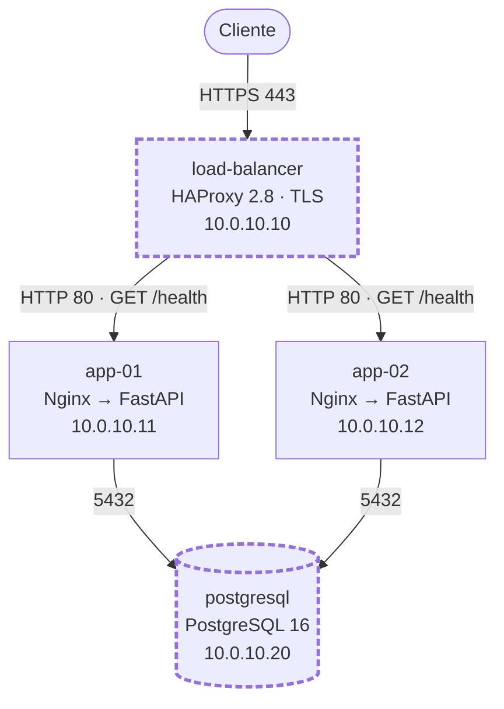
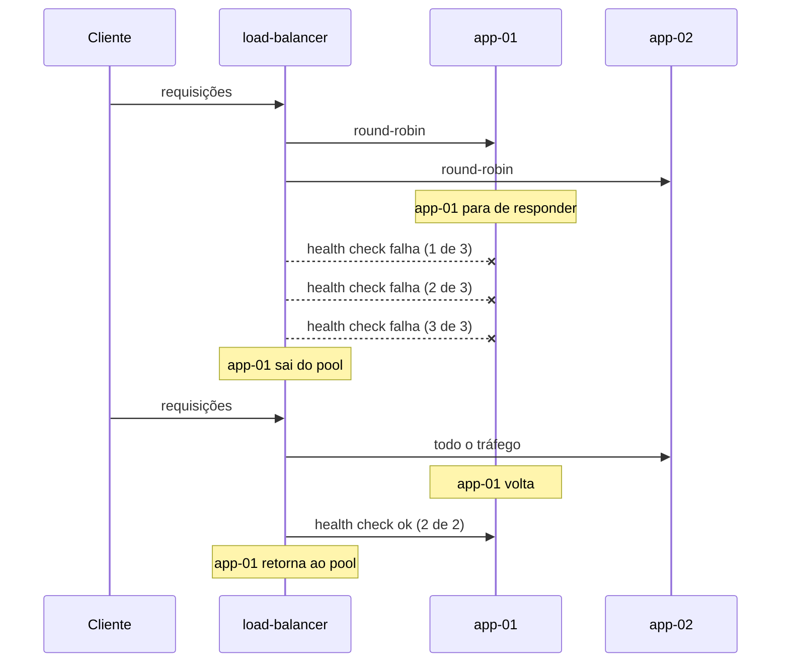

# 03 — Arquitetura atual

> **Estado: implementado e validado em 03/10/2026.** Endereços e domínio são fictícios: faixa privada `10.0.10.0/24` e `api.aegis.example.com`.

## Visão geral

Os dois componentes com borda tracejada são os pontos únicos de falha.

## Fluxo de uma requisição

1. O cliente abre uma conexão HTTPS com o `load-balancer`.
2. O HAProxy termina o TLS e escolhe a próxima instância saudável em round-robin.
3. O Nginx da instância recebe a requisição na porta 80 e a encaminha para a aplicação em `127.0.0.1:8000`.
4. A aplicação responde. As rotas `/ready`, `/api/status` e `/api/events` consultam o `postgresql`.

## Health check

| Parâmetro | Valor | Efeito |
| --- | --- | --- |
| Rota | `GET /health` | Não consulta o banco: mede se o processo da aplicação responde |
| Intervalo | 5 s | Uma checagem por instância a cada 5 s |
| Saída do pool | 3 falhas consecutivas | Detecção em até cerca de 15 s |
| Retorno ao pool | 2 sucessos consecutivos | Retorno em cerca de 10 s |

`/ready` existe para verificar a dependência de banco, mas não é usado pelo balanceador. Se fosse, uma falha do banco retiraria as duas instâncias ao mesmo tempo.

## Failover da aplicação

Validado em 03/10/2026: com `app-01` parada, todas as respostas vieram de `app-02`. Entre a parada e a terceira falha do health check, parte das requisições ainda é enviada ao nó parado; essa taxa de erro não foi medida na origem.

## Limites da arquitetura atual

| Limite | Consequência |
| --- | --- |
| Um load balancer | A falha dele interrompe todo o serviço |
| Um banco, sem réplica | A falha dele interrompe todas as rotas com dados |
| Sem backup comprovado | Perda de dados em caso de falha de disco ou erro operacional |
| Sem métricas, alarmes ou logs centralizados | A falha é descoberta por teste manual ou por reclamação |
| Escala manual | Um pico exige criar e configurar uma nova instância à mão |
| Imagem construída em cada instância | Não há garantia de que as duas instâncias executam a mesma imagem |
| Segredos em arquivo `.env` em cada instância | Rotação manual e sem trilha de auditoria |

Esses limites são a base da [estratégia de migração](04-migration-strategy.md).
