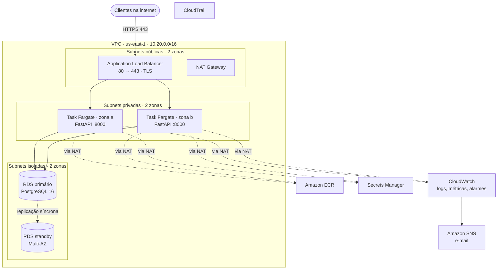

# 05 — Arquitetura alvo na AWS

> **Estado: implementado e validado em 03 e 04/10/2026, em um laboratório efêmero.** O ambiente foi criado por [Terraform](../infra/aws/terraform/README.md) e testado; por ser efêmero, é destruído ao fim da janela de testes e estudo. Os resultados estão em [docs/evidence/2026-10-03-aws.md](evidence/2026-10-03-aws.md). O perfil resiliente e os itens marcados como roadmap continuam sendo proposta.

A arquitetura alvo mantém a aplicação como monólito containerizado e troca cada componente operado à mão por um serviço gerenciado distribuído em duas zonas de disponibilidade.

## Visão geral

## Rede

| Camada | Blocos | Conteúdo | Rota para a internet |
| --- | --- | --- | --- |
| Pública | `10.20.0.0/24`, `10.20.1.0/24` | Load balancer e NAT Gateway | Internet Gateway |
| Privada | `10.20.10.0/24`, `10.20.11.0/24` | Tasks da aplicação | Somente saída, pelo NAT Gateway |
| Isolada | `10.20.20.0/24`, `10.20.21.0/24` | Banco | Nenhuma |

Um endpoint de gateway do S3, sem custo, tira do NAT o tráfego das camadas da imagem.

### Security groups

| Grupo | Entrada | Saída |
| --- | --- | --- |
| Load balancer | 443 e 80 da internet | 8000 para o grupo das tasks |
| Tasks | 8000 apenas do grupo do load balancer | 5432 para o grupo do banco; 443 para registro, logs e segredos |
| Banco | 5432 apenas do grupo das tasks | Nenhuma |

## Entrada

- Application Load Balancer em duas zonas.
- Listener 80 redireciona para 443 com código 301.
- Listener 443 com política de TLS 1.2 no mínimo e cabeçalho HSTS.
- Target group do tipo IP, com health check em `GET /health` a cada 10 s; sai após 3 falhas, volta após 2 sucessos.
- Tempo de drenagem de 30 s antes de remover uma task.

O health check continua em `/health`, não em `/ready`: um failover do banco leva tipicamente de 60 a 120 s e, com `/ready`, todas as tasks seriam marcadas como não saudáveis ao mesmo tempo.

**Certificado.** Um certificado público do ACM exige um domínio. Sem domínio próprio, o laboratório usa um certificado autoassinado importado no ACM, e os testes usam `curl -k`. A criptografia em trânsito existe; a validação de identidade pelo cliente, não. Com domínio, basta informar `certificate_arn`.

## Containers

- Imagem no Amazon ECR, com tags imutáveis e scan no push.
- Serviço ECS em Fargate com duas tasks, distribuídas entre as zonas.
- Deploy rolling com 100% de capacidade mínima e reversão automática por circuit breaker.
- Container sem root, com sistema de arquivos somente leitura.
- O Nginx da origem não é migrado ([ADR-005](adr/ADR-005-remove-nginx-in-target.md)).
- Sem auto scaling na primeira entrega: a política de escala entra quando houver métrica para calibrar.

## Banco

- RDS for PostgreSQL 16, mesma versão principal da origem.
- Criptografia em repouso e TLS obrigatório (`rds.force_ssl`); a aplicação conecta com `sslmode=verify-full`.
- Multi-AZ por variável: desligado no dia a dia do laboratório, ligado na janela de teste e permanente no perfil resiliente ([ADR-003](adr/ADR-003-rds-multi-az.md)).
- Multi-AZ é disponibilidade, não escala: o standby não atende leitura.

### Backup e recuperação

| Mecanismo | Laboratório | Perfil resiliente |
| --- | --- | --- |
| Backup automático com recuperação point-in-time | 1 dia | 14 dias |
| Snapshot final na exclusão | Não | Sim |
| Proteção contra exclusão | Não | Sim |
| Teste de restauração | Na fase 6 | Periódico |
| AWS Backup, com cópia para outra região | Roadmap | Roadmap |

Um backup só é considerado válido depois de restaurado em uma instância nova.

## Segredos e identidade

| Segredo | Quem gera | Quem lê |
| --- | --- | --- |
| Senha mestre do banco | RDS, com rotação automática | Somente o papel de execução da migração |
| Usuário de banco da aplicação e token de eventos | Infraestrutura como código, por recurso efêmero | Somente o papel de execução da aplicação e o da migração |

- O usuário de banco da aplicação tem `SELECT` e `INSERT` na tabela, sem DDL.
- O papel da task não tem políticas: a aplicação não chama APIs da AWS.
- Nenhum segredo fica em variável, plano ou state do Terraform. A exceção, documentada, é a chave do certificado autoassinado do laboratório.

## Observabilidade

Logs da aplicação em JSON no CloudWatch Logs, métricas nativas do load balancer, do ECS e do RDS, onze alarmes com notificação por e-mail e um dashboard. Um alarme foi disparado por falha real e outro por estado forçado; os demais não tiveram disparo real.

## Perfis e custo

Estimativas em us-east-1, sob demanda, 730 horas por mês, conferidas em 03/10/2026. Valores do RDS são aproximados. No laboratório executado, a classe `db.t4g.micro` não estava disponível para a conta e o banco rodou como `db.t3.micro`, de custo semelhante.

| Item | Laboratório | US$/mês | Resiliente | US$/mês |
| --- | --- | --- | --- | --- |
| Fargate | 2 tasks de 0,25 vCPU e 0,5 GB | 18,02 | 2 tasks de 0,5 vCPU e 1 GB | 36,04 |
| Load balancer e IPv4 públicos | 1 ALB | 24,31 | 1 ALB | 29,57 |
| NAT Gateway | 1 | 36,73 | 2 | 73,90 |
| RDS | db.t4g.micro Single-AZ, 20 GB | 13,98 | db.t4g.small Multi-AZ, 50 GB | 58,22 |
| WAF | Não usado | 0,00 | 3 regras | 8,60 |
| Demais | Segredo, alarmes, DNS, registro, armazenamento | 1,60 | Inclui Container Insights, chave KMS e backup | 15,30 |
| **Total** | | **94,64** | | **221,63** |

O laboratório é efêmero: ligado no perfil da tabela custa cerca de US$ 0,13 por hora (cerca de US$ 0,15 com o banco em Multi-AZ) e é destruído ao fim de cada janela de uso.

### Concessões do laboratório

| Concessão | Risco aceito | No perfil resiliente |
| --- | --- | --- |
| Um NAT Gateway | A saída para a internet depende de uma zona | Um por zona |
| Banco Single-AZ fora da janela de teste | O banco continua ponto único de falha | Multi-AZ permanente |
| Certificado autoassinado | O cliente não valida a identidade do servidor | Certificado público do ACM |
| HTTP entre load balancer e task | Tráfego interno sem criptografia | Avaliar TLS até o container |
| Sem WAF | Sem filtragem de camada 7 | Regras gerenciadas e limite de taxa |
| Tópico SNS sem chave própria | Mensagens de alerta sem criptografia com chave do cliente | Chave KMS dedicada |

## Plano de testes de alta disponibilidade

| Teste | Como | Resultado esperado |
| --- | --- | --- |
| Distribuição | `scripts/test-ha.sh` | Respostas de duas tasks distintas |
| Perda de uma task | Interromper uma task durante `scripts/test-failover.sh` | Serviço segue respondendo; nova task é iniciada |
| Deploy defeituoso | Publicar uma imagem que falha no health check | Circuit breaker reverte para a versão anterior |
| Failover do banco | Reinício com failover, com Multi-AZ ligado | `/ready` falha por um intervalo medido e volta sem intervenção |
| Restauração | Restaurar o backup em uma instância nova | Schema e dados íntegros |
| Redirecionamento | `scripts/smoke-test.sh` | HTTP responde 301 para HTTPS |

Todos os testes da tabela foram executados; os resultados medidos estão em [docs/evidence/2026-10-03-aws.md](evidence/2026-10-03-aws.md).
